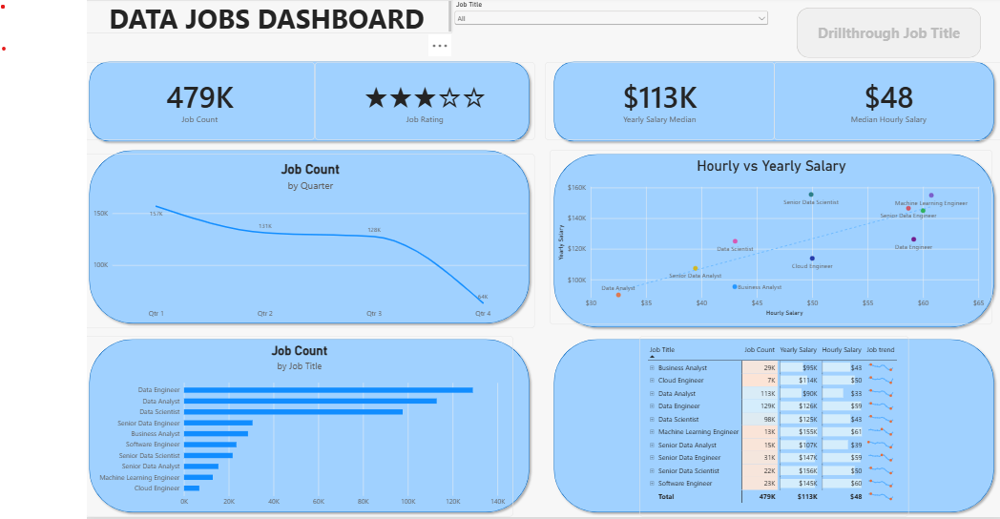

# My Power BI Dashboard Portfolio
This repository is a collection of my Power BI dashboards and projects. Each dashboard has its own folder with a dedicated README file that explains what the project is about, the pages it contains, the skills I used and what I learnt while building it. I'm adding new dashboards as I keep learning and improving, so check back for updates.
# Featured Dashboards
Explore the dashboards below. Each has its own dedicated readme with more details on the build process and specifics.
## 📊 Data Jobs Dashboard
=======
# Data Jobs Dashboard w/ Powerbi

# Introduction
Hi, I’m **Abejide Ayobami**. I’m a **Computer Science and Mathematics student** at Obafemi Awolowo University (OAU), Nigeria, and I’m learning data analytics by building real projects.

[🔗 **View Interactive Dashboard on Power BI Service**](https://app.powerbi.com/groups/me/reports/f5d06f55-a3d7-45b0-b143-f5c957a17368?experience=power-bi)

**Key Power BI Skills Utilized:**
* 🎨 Dashboard Layout & Design
* 🔗 Basic Data Modelling (Table Relationships)
* 📊 Core Charts (Bar, Line, Scatter)
* 🔢 KPI Cards & Detailed Data Tables
* 🎛️ Interactive Slicers for Filtering
* 🔘 Buttons for Page Navigation
* ➡️ Drill-Through Functionality (page and button)
[📁 **View Project 1 README**](data_jobs_v1/README.md)
=======
