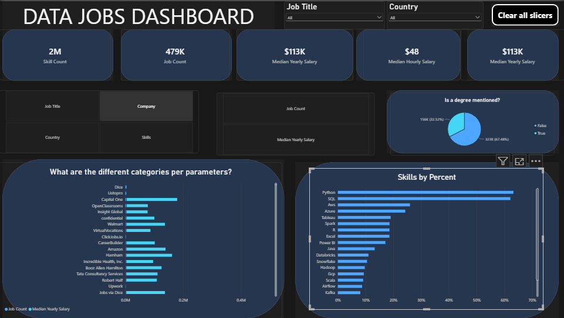

# Data Jobs Dashboard (V2) - Skills & Insights Deep Dive

[🔗 **View Interactive Dashboard on Power BI Service**](https://app.powerbi.com/groups/me/reports/f5d06f55-a3d7-45b0-b143-f5c957a17368?experience=power-bi&clientSideAuth=0)

## Introduction

Hi, I'm **Abejide Ayobami**. I'm a **Computer Science and Mathematics student** at Obafemi Awolowo University (OAU), Nigeria, and I'm learning data analytics by building real projects.

This is my second Power BI project. After building my first Data Jobs Dashboard, I wanted to go deeper and answer a new question: **which skills do data employers ask for most, and how do job count and pay change across job titles, companies and countries?**

## What the Dashboard Does

The dashboard analyzes **479K data job postings** and **2M skill mentions**. It lets you:

- See key numbers at a glance: skill count, job count, median yearly salary and median hourly salary
- Switch the main chart between **Job Title, Company, Country and Skills**, and between **Job Count and Median Yearly Salary**
- See which skills appear most often in job postings, led by Python and SQL, followed by AWS, Azure and Tableau
- Check how many postings mention a degree (about 32.5% do, and 67.5% don't)
- Filter the whole report by **Job Title** and **Country**
- Reset every filter with one click using the **Clear all slicers** button

## Key Power BI Skills Utilized

* 🎨 Dashboard Layout & Design (dark theme, rounded cards)
* 🔗 Data Modelling (linking job postings to skills)
* 🔢 KPI Cards for headline metrics
* 📊 Core Charts (Bar charts and Pie chart)
* 🎛️ Interactive Slicers for Filtering
* 🔄 Field Parameters for switching categories and measures
* 🔘 Buttons & Bookmarks (Clear all slicers)

## Dashboard Overview

### Page 1: Skills & Market Overview

The page opens with KPI cards for skill count, job count and median salaries. Below them, toggle buttons let you change what the main bar chart shows (job title, company, country or skills) and which measure it uses. The pie chart shows how often a degree is mentioned, and the Skills by Percent chart ranks the skills employers ask for most.

## Conclusion

This project showed me that Python and SQL are the most requested skills in data job postings, with cloud platforms like AWS and Azure close behind. It also showed that most postings don't mention a degree, which is encouraging for people learning on their own.

## Lessons Learnt

Building this dashboard taught me how to make one visual flexible so it can answer several questions, how to add a reset button so users can recover from heavy filtering, and how to design a cleaner, more consistent layout than my first dashboard. Improving step by step, from V1 to V2, is one of the best ways to grow.

## Next Steps

I plan to add more pages, such as a drill-through for individual skills, and explore salary trends by location and skill.